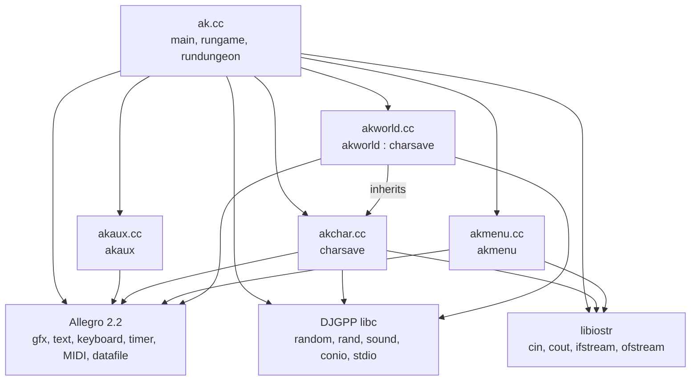
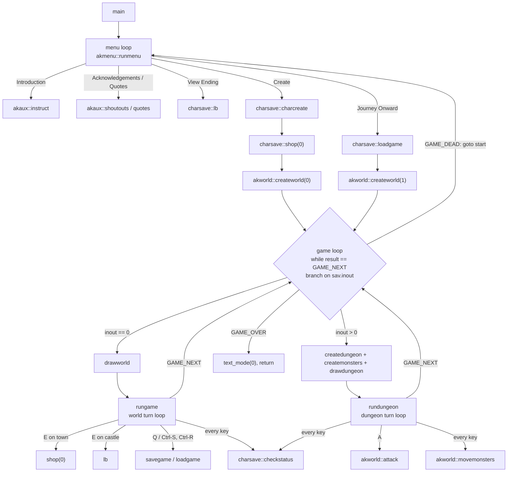

# Engine breakdown: Akalabeth: World of Doom (MS-DOS port, 1997/98)

How the program AK.EXE works as a piece of software. It covers the build layers, boot, the loops,
memory, the two views, input, sound, files and the random numbers. The source is the C++ in
`src/`, which rebuilds AK.EXE byte for byte ([../README.md](../README.md),
[HANDOFF.md](HANDOFF.md)). The rules of the game (formulas, odds, quests) are in
[game/](game/README.md) and are linked, not repeated. The bugs are in [FINDINGS.md](FINDINGS.md),
the save file and AK.DAT in [FORMATS.md](FORMATS.md), and the contents of the executable, object
by object, in [MAP.md](MAP.md).

Conventions:
- A citation is `file` `function` (hex address in AK.COF from MAP.md where it helps). Constants
  are those of `src/akdefs.h`.
- **(inferred)** marks a conclusion drawn from the code but not stated in it or shown by a tool.
  **(outside knowledge)** marks a claim that rests on facts outside this repository.
- For Allegro 2.2 and DJGPP 2.01 the behaviour described is that of their sources:
  `tools/alleg22.zip`, and `build/tc/DJLSR` from `djlsr201.zip`. The linked library objects
  were rebuilt and compared as identical (`tools/libmatch.py`, MATCHING.md), so those sources
  are the code that runs.
- Nothing here was checked in the running game. That is also the status of docs/game/
  ([game/README.md](game/README.md)).

---

## 1. Program structure & build

### The three layers of AK.EXE

```
AK.EXE (238962 bytes)
+-------------------------------------------------------------+
| WDOSX 0.97 kernel        MZ, 16-bit, LZ-packed in place      |  file 0000-25F8
|   DOS extender + DPMI host; finds and loads the WFSE entry   |
+-------------------------------------------------------------+
| go32stub v2.00T          WDOSX's DJGPP COFF loader (MZ)      |  25F8-2A21
+-------------------------------------------------------------+
| WFSE "WdosxMain"         the DJGPP COFF program, 140 chunks  |  2A21-end
|                          of 4096 bytes, each WDOSX-Packed    |
+-------------------------------------------------------------+
                 | unpacks to
                 v
AK.COF (570462 bytes, i386 COFF, not stripped, entry 0x10A8)
  crt0.s | ak.cc akaux.cc akchar.cc akmenu.cc akworld.cc | Allegro 2.2 (40 objects)
         | libiostr (22) | libgcc (7) | DJGPP 2.01 libc (193)
```

Sources: MAP.md ("The file", "All objects in link order"), `tools/wdosx.py`,
`tools/postlink.py` docstring. The program is a 32-bit flat protected-mode program. There are no
segments to speak of and no overlays. `.text` runs from 0x10A8 to 0x52000, `.data` from 0x52000
to 0x58A00 and `.bss` from 0x58A00 to 0x61600 (MAP.md). The WDOSX wrapper is probably not the
original's. README.NOW asks for CWSDPMI, which means a plain `stubify` stub, and the WDOSX
copyright runs to 2002, so a re-release re-stubbed the program (PLAN.md 2.1) **(inferred)**.

### Toolchain

| layer | tool | evidence |
|---|---|---|
| game C++ | gcc 2.7.2.1 for DJGPP, `-O0`, plus `-g` for ak.cc only, assembled by binutils 2.8.1 | MATCHING.md "The toolchain (proven)" |
| Allegro 2.2 | same gcc, `-m486 -O3 -ffast-math -fomit-frame-pointer`, binutils 2.7 | MATCHING.md; rebuilt by `tools/buildalleg.py` |
| C++ runtime | libg++ 2.7.1 `libiostr.a` (iostream, fstream) | MAP.md objects 46-67 |
| C runtime | DJGPP 2.01 libc, libgcc, crt0, linked as shipped | MAP.md objects 68-267 |
| link | `ld -o ak crt0.o ak.o akaux.o akchar.o akmenu.o akworld.o -lalleg -liostr -Tdjgpp.djl -lgcc -lc -lgcc` | `tools/build.py` `build()`; MATCHING.md "The link" |
| wrapper | WDOSX 0.97 kernel and stub copied from the GOG file; WFSE entry and WDOSX-Pack 1.07 redone in Python | `tools/postlink.py` `wfse()`, `tools/wpack.py` |

WHATS.NEW says Revision 1 was built with Borland Turbo C++ 3.0. Revision 2, this one, was ported
to DJGPP and Allegro and "reorganized code into several objects". Traces of Revision 1 may
survive in the code (sections 7 and 16).

### Source-module map

All five game objects together hold 36 functions and **no `.data` or `.bss`** of their own.
Every literal sits in `.text` (MAP.md "The game").

| file | class | functions (address) | role |
|---|---|---|---|
| `src/ak.cc` (`-g`) | none | `rungame` 001600, `rundungeon` 001ED4, `main` 003834 | the game loops: boot, menu, world-map turn loop, dungeon turn loop |
| `src/akaux.cc` | `akaux` (no members) | ctor 003D08, `hello`, `instruct`, `quotes`, `shoutouts` | the screens around the game: AK.DAT check, "Ready?", instructions, scrolling quotes and credits |
| `src/akchar.cc` | `charsave` | ctor, `charcreate` 005134, `shop` 0056B8, `savegame`, `loadgame`, `lb` 0064CC, `checkstatus` 006C98, `death` | the character record and everything that edits it outside the dungeon, plus the per-turn upkeep |
| `src/akmenu.cc` | `akmenu` | `runmenu` 007240, `draw`, `redraw` | the main menu |
| `src/akworld.cc` | `akworld : charsave` | ctor 007A48 (perspective tables), `createworld`, `drawworld`, `createdungeon`, `drawdungeon` 00991C, `createmonsters`, `drawmonsters` 00D244, `attack` 016C28, `movemonsters` 018194, `sgn`, `viewintro` (dead) | the maps, both views, the monsters, combat |
| `src/akdefs.h` | none | none | named constants added in the readable pass (phase 5); `#define`s only |
| `src/ak.h` | none | none | AK.DAT object indexes (reconstructed grabber header) |



The class layouts come from ak.cc's debug symbols (MAP.md "Classes"). Section 4 has the
layouts. One structural oddity: `akworld` *inherits* `charsave`, so every `akworld` carries a
second, unused character record. The real player record is the separate `charsave player` in
`main`, passed to the world's methods as `charsave::savestruct &` (`src/akworld.h`). Only
`viewintro`, which nothing calls, touches the inherited copy.

### How the matched build constrains the source

The source must compile to the same bytes, so its shape is fixed. ak.cc's 316 line numbers are
in the debug information, so no statement in ak.cc may change lines. gcc's label numbers count
across each file, headers included, and the order of functions changes code through a gcc global
(MATCHING.md "Dead jumps"). HANDOFF.md "Changing the source" has the rules. For this document the
practical consequence is that the code reads as Corey Roth wrote it. Odd forms such as bitwise
`&`/`|` for logic, empty `if` branches and unused labels are original, not decompiler artefacts.

---

## 2. Boot & initialization

### From DOS to `main`

1. DOS loads the MZ header. The WDOSX kernel unpacks its 16-bit image in place, switches to
   protected mode as (or through) a DPMI host, and loads `WdosxMain` from the WFSE container,
   unpacking it chunk by chunk (MAP.md "The file"; `tools/wdosx.py`) **(the kernel's internals
   are inferred from the format, not traced)**.
2. Control enters `start` in crt0.s at 0x10A8 (MAP.md). DJGPP's crt1 then sets up the C
   environment and runs the static constructors. These include libiostr's standard streams
   (`stdstreams.cc`) and the conio state that `gotoxy` uses later.
3. `main` (`src/ak.cc`, 003834) runs.

### `main`'s start-up sequence

The order is the order of declarations and calls in `main`. C++ constructors run where the
object is declared, so object construction is part of the boot sequence:

| step | code | what it does |
|---|---|---|
| 1 | `akaux aux;` | `akaux::akaux` loads `ak.dat` only to see that it exists, then drops the pointer without unloading it. On failure it prints "Error Loading AK.DAT!" and exits. **This runs before `allegro_init`**, and on failure it calls `allegro_exit` before Allegro was ever started |
| 2 | `charsave player;` | `charsave::charsave` sets `count = 0`; the record is otherwise uninitialised stack memory |
| 3 | `allegro_init()` | Allegro: detects Windows (INT 2Fh AX=1600h) and the CRTC port, registers `allegro_exit` with `atexit`, installs signal handlers, sets `_CRT0_FLAG_NONMOVE_SBRK` (Allegro `src/allegro.c`) |
| 4 | `install_keyboard()` | Allegro's INT 9 handler takes over the keyboard (section 7) |
| 5 | `install_timer()` | Allegro reprograms PIT channel 0 and chains the BIOS clock (section 3) |
| 6 | `install_sound(DIGI_NONE, MIDI_AUTODETECT, argv[0])` | MIDI only. Allegro reads `sound.cfg` from argv[0]'s directory, or else from `$ALLEGRO` (Allegro `src/sound.c` `parse_cfg_file`). On failure the game prints "Please Run SETUP.EXE..." and exits |
| 7 | `set_gfx_mode(GFX_VGA, 320, 200, 0, 0)` | mode 13h. **The return value is not checked** |
| 8 | `akworld w;` | `akworld::akworld` creates `worldbmp`, a sub-bitmap of `screen`, and computes the perspective tables (section 6). It is declared *after* `set_gfx_mode` because it needs `screen` **(inferred: the only reason the declaration stands there)** |
| 9 | `aux.hello()` | "Ultima 0 - Akalabeth!" and "Ready?". `N` prints "Then Leave and Begone!", waits for a key, calls `text_mode(0)` and exits |
| 10 | `akmenu menu;` then `start:` | the menu loop (section 3) |

**Hardware detection** is limited to what Allegro does on its own: Windows and the CRTC port in
`allegro_init`, and the MIDI device through SOUND.CFG or autodetection in `install_sound`. The
graphics driver is fixed (`GFX_VGA`, no autodetect, no SVGA). The game makes no CPU, memory or
joystick checks. SETUP.EXE, Allegro's stock setup program, writes SOUND.CFG
([FORMATS.md](FORMATS.md) "SOUND.CFG"). The GOG file asks for `midi_card = 2`, which is
`MIDI_OPL2` in Allegro 2.2's `allegro.h`.

**Making the world.** After the menu, `main` calls `akworld::createworld(0, ...)` for a new
character (after `charcreate` and a first visit to the shop) or `createworld(1, ...)` after
Journey Onward. The world is never stored, only regenerated from the lucky number (section 5,
[game/world.md](game/world.md)).

**Shutdown.** Ctrl-Q or Ctrl-E ends `rungame`/`rundungeon` with `GAME_OVER`. `main` then calls
`text_mode(0)` and falls off its end. Allegro's `text_mode(int)` only sets the background colour
of later `textout` calls (Allegro `src/text.c`: "If mode is positive, text output will be opaque
and the background will be set to mode"), and 0 is already the default. The authors probably
took it for "return to text mode" **(inferred)**. The real return to text mode happens in
`allegro_exit`, which runs from `atexit` and calls Allegro's exit functions, among them
`shutdown_gfx` → `set_gfx_mode(GFX_TEXT, ...)` (Allegro `src/graphics.c`).

---

## 3. Main loop & timing

### Loop structure

The program is a set of nested blocking loops. Every one of them waits in `readkey()`:



- **Menu loop** (`main`, `while (result != MENU_CREATE & result != MENU_JOURNEY)`). Each pass
  loads intro.mid and calls `akmenu::runmenu`, which loops on `readkey() >> 8` until Enter.
- **Game loop** (`main`, `while (result == GAME_NEXT)`). It is a two-state machine on
  `player.sav.inout`: 0 means the surface, n > 0 means dungeon level n. Every pass into the
  dungeon branch builds the level and its monsters again. `GAME_DEAD` jumps back to `start:`,
  which is the menu. The `akworld` object and its tables survive that jump.
- **Turn loops** (`rungame`, `rundungeon`): `while (ky2 != CTRL_Q & ky2 != CTRL_E)`, one key per
  pass. They return `GAME_NEXT` whenever the place changes (dungeon entered or left, level
  changed, game loaded), so a level change always goes back out through `main`.
- **Modal sub-loops** with their own `readkey`: `shop`, `lb`, `attack` (choice of weapon and
  spell), `death`, `charcreate`, `instruct`. Inside them no turns pass: `shop(0)` never calls
  `checkstatus`, so only the key that opened the shop (or castle, or attack) counts as a turn.

### One dungeon turn (`rundungeon`)

```
readkey()                        block until a key (busy-wait in Allegro)
clear message lines 175/183/191  textout of spaces
switch (key >> 8)                arrows, then the Alt codes (section 7): move or turn
                                 -> drawdungeon (mdraw 0: clear the view, corridor only)
switch (key & 0xff)              E/K/X climb (return GAME_NEXT), A attack, Z stats,
                                 Q/Ctrl-S refused, Ctrl-R load (return), space redraw
if the key was a step            trap: whistle, damage, inout++, return GAME_NEXT
                                 chest: gold and an item, cleared from dng
compass word                     from (dx, dy)
movemonsters()                   every monster acts; may call drawdungeon if one fled
mdraw = 1; drawdungeon(); mdraw = 0    overlay the corridor again plus the monsters
checkstatus()                    food, death, status lines -> maybe return GAME_DEAD
```

`rungame` is the same without monsters: the arrows move and redraw (`drawworld`), the letter
keys act, and then comes `checkstatus`. [game/README.md](game/README.md) "Turns" covers the rules
side of this (food per turn, what counts as a turn).

### What drives time

**Key presses only.** There is no frame loop, no tick counter and no idle processing in the
game's code. A turn is one return from `readkey()`. Monsters move only inside the turn
(`movemonsters` is called once per key in `rundungeon`). Food is eaten only in `checkstatus`.
An idle player stops the world.

Allegro's timer exists for three things, none of them game logic:

| user | mechanism |
|---|---|
| `rest(ms)` | Allegro `src/djgpp/timer.c` `rest`: installs a 1 ms callback (`install_int(rest_int, 1)`) and busy-waits until the counter runs out. If the timer were not installed it would return at once |
| the MIDI player | Allegro `src/midi.c` `play_midi`: `install_int(midi_player, 20)`, and the interrupt then adjusts its own rate. The music therefore keeps playing while the game sits in `readkey` |
| the BIOS clock | Allegro's PIT handler keeps calling the old 18.2 Hz handler (`bios_counter` in timer.c) |

Allegro programs PIT channel 0 at a variable rate for whatever callbacks are due. The game's
own `sound()` beeps use channel 2 (section 8), so the two do not collide.

The delays the game asks for, all through `rest`:

| delay | where |
|---|---|
| 50 ms | beep when a mountain blocks (`rungame`) |
| 201 x 4 ms | trap whistle, 2000 Hz down to 1000 Hz in steps of 5 (`rundungeon`) |
| 500 ms | chest chime (`rundungeon`) |
| 200 ms + 300 ms | hit or miss beep, then a pause at the end of every attack (`attack`); 200 ms beep for a monster's hit or miss (`movemonsters`) |
| 300 + 300 ms | two-note jingle when the quest monster dies (`attack`) |
| 1500 ms | "Invalid Choice!" in character creation (`charcreate`) |
| 100 ms per pixel | quotes and credits scroll (`akaux::quotes`, `shoutouts`) |
| 300 ms per step | intro demonstration (`viewintro`, never called) |

### CPU-speed dependence

The **game logic does not depend on the CPU's speed**. Turns are key presses, and every delay is
measured by the PIT through `rest`. Two things do scale with the CPU **(inferred)**:
- **Drawing time.** Everything is drawn straight into video memory without double buffering
  (section 6). On a slow machine the view is visibly cleared and redrawn line by line. GOG's
  DOSBox profile sets `cycles=fixed 1500` (`gamedata/dosboxAkalabeth.conf`), which slows only
  that.
- **Type-ahead.** Allegro buffers 256 key codes (`KEY_BUFFER_SIZE`, keyboard.c). A held key's
  typematic repeats are queued as turns and played out as fast as the redraws allow.

---

## 4. Core data structures & memory layout

### No global state

The game objects have no `.data` or `.bss` (MAP.md). All game state lives in four class
instances that are **locals of `main`**, on the stack. Their frame offsets come from ak.cc's
debug symbols (MAP.md "ak.cc's functions"):

| local | type | size | frame offset |
|---|---|---|---|
| `aux` | `akaux` | 1 | -0x28 |
| `player` | `charsave` | 128 | -0xA8 |
| `w` | `akworld` | 3716 | -0xF2C |
| `menu` | `akmenu` | 16 | -0xF3C |
| `item[7]` | `char *` | 28 | -0x24 |

The whole game state is therefore under 4 KB. Everything else on the heap belongs to Allegro or
libc: the `screen` and `worldbmp` BITMAP structures, the loaded `MIDI`, AK.DAT when it is
loaded, and iostream buffers.

### The records

`charsave` (`src/akchar.h`) is the save record `savestruct sav` (124 bytes, written to PLAYER.U0
as it is; [FORMATS.md](FORMATS.md) has the offsets) plus `int count`, the dungeon turn counter,
which is not saved.

`akworld` (`src/akworld.h`), offsets from MAP.md:

| offset | member | meaning |
|---|---|---|
| 0 | `charsave` base | unused second record (only `viewintro` writes it) |
| 128 | `int world[21][21]` | the surface, `LAND_*`, indexed `[x][y]` |
| 1892 | `int dng[11][11]` | the current dungeon level, `DG_*` plus `DG_MONSTER * m` |
| 2376 | `mdraw`, `color`, `run1` | draw-monsters flag, line colour (level + 30), "a monster fled" flag |
| 2388 | `BITMAP *worldbmp` | the view: a 320x166 sub-bitmap of `screen` |
| 2392 | `MIDI *backmid` | the music now playing |
| 2396-3451 | `per[11][4]`, `cd[11][4]`, `lad[11][4]`, `ld[11][6]`, `ft[11][6]` | perspective tables per distance (section 6) |
| 3452 | `xx[11]`, `yy[11]` | half-width and half-height of the corridor per distance |
| 3540 | `mz[11][2]` | per monster 1..10: alive flag, hit points |
| 3628 | `ml[11][2]` | per monster 1..10: x, y on the level |

Encodings worth knowing:
- **Monsters live in the map.** A monster `m` adds `m * 10` (`DG_MONSTER`) to the cell it stands
  on, so `dng / 10` is the monster and `dng % 10` the terrain under it (`akdefs.h`;
  `createmonsters`, `movemonsters`, `attack`, `drawdungeon`). Collision tests use that: a
  player's step is blocked by `dng == DG_WALL` or `dng >= DG_MONSTER` (`rundungeon`), a
  monster's by `DG_WALL`, `DG_TRAP` or `> 9` (`movemonsters`). The **player is not** in the map.
- **One instance per monster type.** `mz`/`ml` are indexed by monster type 1..10, and index 0 is
  unused. A level holds at most one skeleton, one thief and so on
  ([game/dungeon.md](game/dungeon.md)).
- **Arrays sized N+1, index 0 unused**: `mz[11]`, the `monster[]` name tables (`""` at 0), the
  tables per distance (0 = the player's own square). This matches Applesoft's `DIM A(10)`, which
  gives indexes 0..10 **(outside knowledge; section 16)**.
- **Name tables are stack arrays.** `char *monster[]` is built anew on the stack in each of
  `drawdungeon`, `attack`, `movemonsters` and `lb`, and `char *item[]`/`weapon[]` in four
  places. They are not shared constants.

### Address space

```
0x000010A8  .text  crt0 | game 0x1550-0x19C74 (100 KB, literals inline) | Allegro | libiostr | libgcc | libc
0x00052000  .data  Allegro tables, libc data (no game data)
0x00058A00  .bss   Allegro (keyboard buffer, MIDI state...), libc
0x00061600  end    heap above (sbrk, non-moving per Allegro); stack: host-provided
            video memory at 0xA0000 reached through the _dos_ds selector, not mapped here
```

(MAP.md section table and object list; `_stklen` is an undefined common in `.bss`, so the stack
size is the loader's default **(inferred)**.)

---

## 5. World representation

Two maps. Neither is ever saved: both are generated from the lucky number on demand.

### The surface

- `world[21][21]`, indexed `[x][y]`, x growing east and y south (Up decrements `ty`: `rungame`).
  The border is mountains, which block, so the player can never step off the array.
- The position is `sav.tx`, `sav.ty`. The view (`drawworld`) shows only the 3x3 squares around
  the player. There is no scrolling, no overview and no streaming: the whole map is a 1.7 KB
  array made once per game start by `createworld` ([game/world.md](game/world.md)).

### The dungeon

```
 x: 0 1 2 3 4 5 6 7 8 9 10        # wall (border, and every even row and column)
    # # # # # # # # # # #         . room (odd x, odd y): always floor or a ladder
    # . ? . ? . ? . ? . #         ? gap (even/odd): rolled as door, hidden door,
    # ? # ? # ? # ? # ? #           wall, trap, hole or chest
    # . ? . ? . ? . ? . #         where two even lines cross: always wall
    ...
```

- `dng[11][11]`, `[x][y]`: a lattice of 5x5 one-square rooms joined by rolled gaps
  (`createdungeon`; odds in [game/dungeon.md](game/dungeon.md)).
- **One level in memory at a time.** `main` calls `createdungeon` and `createmonsters` every
  time the dungeon loop starts. Nothing about a level persists: chests refill and killed monsters
  return.
- **Depth is unbounded.** `inout` only ever counts up or down by one, and nothing caps it. Every
  level gets ladders (`createdungeon`), and the line colour `inout + 30` simply walks on through
  the palette.
- **Every dungeon entrance leads to the same dungeon.** The level seed is `ln * 3 + inout`
  (`createdungeon`), with no term for the entrance's `tx, ty`, and `rungame` always starts the
  player at (1,1) facing `dx = 1`. All `LAND_DUNGEON` squares of a world therefore open onto
  identical levels **(read from the code; a consequence the game docs do not state)**.
- **Facing** is a unit vector `(dx, dy)`. Turning is a rotation: left is `(dx, dy) → (0, -dx)`
  when `dx ≠ 0`, else `(dy, 0)` (`rundungeon`). The squares beside the player at distance d are
  `(px + dx*d ± dy, py + dy*d ∓ dx)` (`drawdungeon`). The compass words are labels only and say
  "North" for `dx = -1` and "East" for `dy = -1` (FINDINGS "Oddities").

---

## 6. Rendering

### Video mode, palette, primitives

- **Mode 13h**, 320x200 with 256 colours, set by Allegro's `GFX_VGA` driver through BIOS INT 10h
  AX=13h (Allegro `src/vga.c` `vga_init`). The screen bitmap is linear memory at 0xA0000, reached
  through the `_dos_ds` selector (`_make_bitmap` in `src/graphics.c`).
- **The palette is never set.** No `set_palette` call exists in `src/`, so the game draws with
  the BIOS default VGA palette that mode 13h loads. Text uses the 16 EGA colours (`CLR_*` in
  `akdefs.h`: 9 light blue for values, 11 light cyan for text, 12 light red for alarms, 13 light
  magenta for headings, 15 white for menu entries). The dungeon uses colour `inout + 30`
  (`drawdungeon`). In the default palette 31 is the end of the grey ramp and 32-40 run from blue
  through magenta to red, so each level gets its own hue **(outside knowledge: the VGA default
  palette)**.
- **Only vector primitives and text.** Across `src/` the game calls Allegro's `line` (421 call
  sites), `textout` (216), `textout_centre` (12), `rect` (8), `clear` (18) and `putpixel` (2,
  the gremlin's eyes). There are **no bitmaps, sprites or blits**. All text is drawn in Allegro's
  built-in 8x8 `font`. AK.DAT's two fonts are never used ([FORMATS.md](FORMATS.md)).
- **Opaque text.** Allegro 2.2's `_textmode` defaults to 0 (`src/text.c`), so `textout` paints
  its background black. The game relies on that throughout: it erases a message line by printing
  spaces over it (`rungame`, `rundungeon`, `checkstatus`). The quote scrollers move a column of
  text up one pixel at a time without clearing, and each new opaque row overwrites the old one.
- **No double buffering, no vsync.** Both views draw straight to `screen`, or to `worldbmp`,
  which is a sub-bitmap of `screen` and only adds clipping. A redraw is `clear(worldbmp)`
  followed by the lines, and the player sees it happen.

### Screen layout

```
y   0 +--------------------------------------------------------------+
      |                                                              |
      |             the view: worldbmp = sub-bitmap(0,0,320,166)     |
      |             world: 3x3 squares; dungeon: wire-frame corridor |
  165 +--------------------------------------------------------------+
  167 | x=8: move word ("North", "Forward")   x=140: compass  x=225: monster name / blank
  175 | x=8: messages                                         x=225: Food=
  183 | x=8: messages                                         x=225: H.P.=
  191 | x=8: hit / miss / damage                              x=225: Gold=
  199 +--------------------------------------------------------------+
```

Sources: `akworld::akworld` (the sub-bitmap), the `textout` coordinates in `rungame`,
`rundungeon`, `checkstatus`, `attack`, `movemonsters`. It is the Apple II's mixed graphics mode,
a 280x160 picture over four text lines, scaled to the PC **(outside knowledge for the Apple
mode; the 280x160 scale factors are in the constructor)**.

### The overhead world view (`akworld::drawworld`, 008C34)

- `clear(worldbmp)`, then the nine squares `(tx-1..tx+1, ty-1..ty+1)`. Each is a 58x52 cell at
  `left = (x+1)*58 + 55`, `top = (y+1)*52`, so the 3x3 block is centred on x 142.
- Each land type is a fixed figure of lines and rectangles in colour 11. Mountains are a stepped
  outline of 15 lines. A tree is one small square, a town five squares, a dungeon entrance an X,
  the castle a framed box with diagonals. Plains are empty.
- The player is a small cross at (140..144, 78), drawn only when `inout == 0`. It is drawn inside
  the loop, nine times over.

### The 3-D dungeon view

**Perspective tables, computed once** (`akworld::akworld`, 007A48). For each distance d = 1..10:

```
xx[d] = floor(atan(1/(2d)) / 0.785398 * 140 + 0.5)    half-width on the Apple's 280-wide view
yy[d] = floor(xx[d] * 4/7)                            280:160 aspect
xx[d] = floor(xx[d] / 279 * 320)                      scaled to 320
yy[d] = floor(yy[d] / 159 * 166)                      scaled to 166
per[d] = { 159 - xx, 159 + xx, 83 - yy, 83 + yy }     the corridor's cross-section (l, r, t, b)
per[0] = { 0, 319, 0, 166 }                           the player's own square: the full view
```

That gives cross-sections like d=1: x 64-254, y 34-132; d=2: 109-209, 57-109; d=5: 139-179,
73-93 (computed from the formulas). The other tables are derived from `per` and `xx/yy`: `cd`
is a door frame ahead (a third of the width, 0.7 of the height up), `ld` a door frame in a side
wall (thirds along the side wall), `ft` the trapezoid of a hole in the floor (mirrored as
`166 - y` for the ceiling), and `lad` the ladder's rails, with four rungs at fifths
(`drawdungeon`).

**The corridor walk** (`akworld::drawdungeon`, 00991C). It goes near to far, one square at a
time, with no visibility or occlusion logic beyond "stop at the first solid square ahead":

```
dist = 0
loop:
  ahead = dng[p + dir*dist], left/right = the squares beside it
  split ahead into monster type (ahead / 10) and terrain (ahead % 10)
  (l1,r1,t1,b1) = per[dist]   near frame;   (l2,r2,t2,b2) = per[dist+1]   far frame
  if mdraw and a monster: name it at (225,167) when dist > 1; drawmonsters(type, dist)
  side walls: solid left/right -> two diagonals near->far (ceiling and floor edges)
              open left/right  -> the edge of the side opening (verticals and horizontals)
              door in a side   -> the ld frame (mirrored with 319 - x on the right)
  wall, hidden door or door ahead (dist > 0) -> rectangle per[dist]; a door adds the cd frame;
              -> return
  ladder down / hole -> ft trapezoid on the floor;  ladder up -> mirrored on the ceiling
  ladders -> rails and 4 rungs from lad
  chest (dist > 0) -> a small box sized 11/dist..16/dist above the floor line, "Chest!" text
  dist++
```

A hidden door is drawn exactly like a wall. Every test treats `DG_WALL`, `DG_HIDDEN_DOOR` and
`DG_DOOR` alike as "solid" for the side walls. The `stop` variable and the `done:` label are
never used (the source comments in akworld.cc say so). The walk ends by `return` at a solid
square. The border walls guarantee one by distance 9, so `per[dist+1]` never goes past `per[10]`
**(inferred from the 11x11 map with walls at 0 and 10)**.

**Monsters** (`akworld::drawmonsters`, 00D244, 39 KB of code for 340 `line` calls). Each picture
is a fixed list of strokes around the floor point `(159, 83 + yy[dist])`. **Every offset is an
integer divided by `dist`**, so a monster shrinks as 1/d. That is cruder than the corridor's
atan table, but cheap. The carrion crawler hangs from the ceiling point. The mimic is drawn as a
chest. Three strokes of the daemon lack the `/ dist` (FINDINGS 13). These are the Apple original's
HPLOT figures (the akworld.cc comments). Only monsters **straight ahead** are drawn, since only
`ahead` is decoded. Several monsters in line are all drawn, nearest first, and the name printed
last (the farthest) wins **(inferred)**.

**The two-pass redraw.** A move or turn calls `drawdungeon` with `mdraw = 0`, which clears the
view and draws the corridor. After `movemonsters` the turn loop sets `mdraw = 1` and calls it
again. This pass does **not** clear, so it redraws the same corridor lines and adds the
monsters at their new squares. If a monster fled, `movemonsters` sets `run1` and redraws with
`mdraw = 0`, a clear, before the second pass. Keys whose handler does not redraw (`A` without a
kill, `Q`, Ctrl-S, `y`, unknown keys) reach the second pass without a clear. A monster that
stepped closer during such a turn should then leave its old, smaller picture on screen beside
the new one until the next clearing redraw **(inferred; not in FINDINGS, check in play)**.

### Other screens

All are text plus `clear(screen)`. The menu (`akmenu::draw`/`redraw`) repaints only the
highlighted entry and its neighbours, in white or light red. The shop (`charsave::shop`) is a
static table with in-place number updates right-aligned by digit count. Instructions and Lord
British's speeches are AK.DAT text laid out one line per `;` (section 9). The death message is
four centred lines over the status area (`charsave::death`).

---

## 7. Input

### The keyboard path

```
INT 9 (keyboard IRQ) -> Allegro my_keyint (keyboard.c)
   scan code, shift state -> int code = (scan << 8) | ascii      (extended keys: | shift flags)
   -> 256-entry ring buffer
readkey(): busy-wait until the buffer is non-empty, pop one code
game: ky1 = key >> 8 (scan code)    ky2 = key & 0xff (ASCII / control code)
```

- The game never polls `key[]` and never uses a mouse or joystick. Allegro's `mouse.c` is linked,
  pulled in by `set_gfx_mode`'s `_set_mouse_range`, but `install_mouse` is never called.
- **Two dispatch switches per key**: `switch (ky1)` for movement (`KEY_UP` 72, `KEY_LEFT` 75,
  `KEY_RIGHT` 77, `KEY_DOWN` 80, Allegro's plain scan codes), then `switch (ky2)` for commands
  (letters in both cases; control codes `CTRL_E` 5, `CTRL_Q` 17, `CTRL_R` 18, `CTRL_S` 19 from
  Allegro's `key_control_table`). Both run on every key (`rungame`, `rundungeon`). The command
  tables are in [game/README.md](game/README.md) "Controls".
- The menu reads only the scan code (`akmenu::runmenu`: `readkey() >> 8`, Up/Down/`KEY_ENTER`).
  The modal prompts read only the ASCII byte (`readkey() & 0xff` in `shop`, `attack`, `lb`,
  `hello`).
- **No command is ignored as a turn.** Any key, unknown ones included, runs the monster phase and
  `checkstatus`. "SPACE Pass" in the instructions works on the world map only because every key
  passes.

### The Alt-arrow codes cannot occur

`rundungeon` steps sideways on `SC_ALT_LEFT` (155) and `SC_ALT_RIGHT` (157) and back on
`SC_ALT_DOWN` (160), tested against `ky1`, the high byte of `readkey()`. These are the BIOS
INT 16h codes for Alt+Left/Right/Down (`akdefs.h` says so). **Allegro 2.2's handler never puts
such a value in the high byte** (Allegro `src/djgpp/keyboard.c` `my_keyint`):
- the scan code is masked to 7 bits (`temp &= 0x7F`) before it is shifted, so the high byte is
  at most 127;
- a grey arrow (E0 prefix) with Alt gives `(scan << 8) | (key_shifts & 7)`, i.e. 75/77/80 in
  the high byte and the Alt flag 4 in the low byte. `rundungeon` reads that as a plain turn or
  turn-around;
- a keypad arrow with Alt starts an Alt+numpad sequence and adds nothing until Alt is released.

Strafing and retreating are therefore **unreachable in this build**: Alt+arrow acts as a plain
arrow **(read from the game and Allegro sources; not checked in play)**. The constants look like
a leftover of Revision 1, the Turbo C++ build, where `bioskey()` returns exactly these codes
**(inferred)**. The instructions (AK.DAT `AKINS`) don't mention the moves. This contradicts the
Alt+arrow rows in [game/README.md](game/README.md) "Controls" and the note in HANDOFF.md
"Open work" 4.

### Line input: DOS, not Allegro

The lucky number, the level of play (`charcreate`) and the character's name (`lb`) are read
with `cin >>`. The game brackets these reads with `remove_keyboard()` and `install_keyboard()`,
handing the keyboard back to DOS/BIOS so that DJGPP's stdin reads cooked console input. The echo
lands on the graphics screen at the BIOS cursor, which the game places with conio's `gotoxy`. In
DJGPP `gotoxy(col, row)` calls `ScreenSetCursor(row - 1, col - 1)` (DJGPP `conio.c`), so
`gotoxy(28, 6)` puts the cursor at pixel (216, 40). That is just after the 26-character prompt
"Type thy Lucky Number....." printed at (8, 40). The BIOS teletype draws the echoed characters in
mode 13h with its ROM font **(inferred: DOS echo through INT 10h; colour unverified)**. The other
`gotoxy` calls (before `readkey` in `charcreate`, `gotoxy(1, 13)` in `shop`) and
`textcolor(CLR_LIGHTCYAN)` in `shop` have no visible effect, since no conio output follows
**(inferred: leftovers of the Turbo C++ revision)**. The reads go through an uninitialised
pointer and an unchecked buffer (FINDINGS 5, 8).

### Other input details

- `keypressed()` polls end the scrolling screens, then `clear_keybuf()` discards the key
  (`akaux::quotes`, `shoutouts`).
- Case: the movement switches accept both cases (`'E': case 'e':`). The class choice folds case
  with `if (key <= 'Z') key += 32` (`charcreate`). `attack` accepts only lower-case weapon
  letters, so an upper-case letter falls through to bare hands. WHATS.NEW v0.955: "Fixed Several
  Places where you could not do input with capital letters".
- **Pause is gone.** The instructions list `P` "Pause On/Off", but no `P` case exists. WHATS.NEW:
  "Tooks out some pausing features that were relevant only on an Apple IIe". `rundungeon` has 13
  statement-free lines before `case 'y': break;`, and the debug line table shows them as a gap
  (ak.cc comment). That may be where it was **(inferred)**.
- Undocumented keys (README.NOW): `Q` saves, Ctrl-Q and Ctrl-E quit, Ctrl-R restores.

---

## 8. Sound & music

Two independent outputs, and no digital sound (`install_sound(DIGI_NONE, ...)`).

### Effects: the PC speaker

`sound(freq)` is DJGPP libc's (`sound.c`, object 80 in MAP.md). It programs PIT channel 2 with
divisor `1193046 / freq` through ports 0x43/0x42 and gates the speaker on with port 0x61.
`sound(0)` gates it off. Every effect is `sound(f); rest(ms); sound(0);`, so effects **block**
the game for their length:

| effect | frequency, duration | where |
|---|---|---|
| blocked by a mountain | 100 Hz, 50 ms | `rungame` |
| trap | sweep 2000 → 1000 Hz, 201 steps of 4 ms | `rundungeon` |
| chest | 2000 Hz, 500 ms | `rundungeon` |
| player misses / hits | 100 Hz / 2000 Hz, 200 ms | `attack` |
| quest monster killed | 1500 Hz then 2000 Hz, 300 ms each | `attack` |
| monster misses / hits | 100 Hz / 2000 Hz, 200 ms | `movemonsters` |

WHATS.NEW: "Added PC speaker beeps similar to the Apple IIe version."

### Music: Allegro MIDI

- `install_sound(DIGI_NONE, MIDI_AUTODETECT, argv[0])` picks the MIDI driver from SOUND.CFG
  (GOG: `midi_card = 2`, OPL2 FM) or by autodetection. Allegro's drivers for AdLib/OPL, SB MIDI
  out, MPU-401, GUS and DIGMID are all linked (`adlib.c`, `sb.c`, `mpu.c`, `gus.c`, `digmid.c`
  in MAP.md).
- The player runs in the timer interrupt (section 3), independent of the game's blocking loops.
- Five files, one per state ([FORMATS.md](FORMATS.md) "SOUND.CFG" table). Every state change
  is the same three calls, `destroy_midi(w.backmid); w.backmid = load_midi("x.mid");
  play_midi(w.backmid, -1);`, the -1 being a true loop flag (`rungame` around `shop` and `lb`,
  `rundungeon`, `main`). `destroy_midi` stops a playing tune first (Allegro `src/midi.c`).
- A missing file makes `load_midi` return NULL, and `play_midi(NULL, ...)` just stops the
  music. That is why WHATS.NEW can say "just delete the midi files" for silence **(inferred
  from Allegro's `play_midi`)**.
- The menu loop leaks one MIDI per pass on some paths (FINDINGS 10).

---

## 9. File I/O, data formats & saving

| file | read/written by | API | when |
|---|---|---|---|
| `ak.dat` | `akaux::akaux`, `akaux::instruct`, `charsave::lb` | Allegro `load_datafile` / `unload_datafile` | start (existence check, leaked), each instructions view, each castle visit |
| `*.mid` | `main`, `rungame`, `rundungeon` | Allegro `load_midi` | each state change |
| `sound.cfg` | Allegro `install_sound` | Allegro packfile | start |
| `player.u0` | `charsave::savegame` / `loadgame` | libc `fopen("wb"/"rb")`, `fwrite`/`fread` of `sizeof(sav)` | Q / Ctrl-S on the surface; Ctrl-R; Journey Onward |
| `quotes.flg`, `endgame.flg` | `akmenu::runmenu` (exists?), `charsave::lb` (create) | libiostr `ifstream` / `ofstream` | each menu pass; balrog quest at level 10 |

- **All paths are relative and lower case**, so the game must be started from its own
  directory. Only SOUND.CFG is found next to `argv[0]`.
- **The save** is a raw dump of the 124-byte `savestruct`: no header, version or checksum, and
  the world is not in it ([FORMATS.md](FORMATS.md)). `loadgame` overwrites `player.sav` in
  place. Ctrl-R mid-game does not rebuild the world (FINDINGS "Oddities"). Saving in a dungeon is
  refused (`rundungeon`), so a save always has `inout = 0`.
- **AK.DAT** is an Allegro 2.2 datafile inside an LZSS packfile (`slh!`), which Allegro unpacks
  on load ([FORMATS.md](FORMATS.md); `tools/akdat.py list` shows 7 objects, made 13-20 November
  1997 in `c:\djgpp\bin`). The game reads only the four DATA objects and treats them as markup:
  `strsep(&text, ";")` splits lines, a line holding `~` ends a page, and a line holding a
  backtick is skipped (`akaux::instruct`, `charsave::lb`). The parse is destructive: `strsep`
  writes NULs into the loaded copy. That is harmless only because each view loads a fresh copy
  **(inferred)**.
- **The flag files** are the only use of C++ file streams. Their existence is the whole content
  ([game/lordbritish.md](game/lordbritish.md)).
- Compression appears twice, both outside the game's code: LZSS in AK.DAT (Allegro) and
  WDOSX-Pack around the executable (`tools/wpack.py`).

---

## 10. Scripting / conversation engine

Not applicable: there is no script language, bytecode or conversation system. The nearest thing
is AK.DAT's text with its three markers (section 9). Lord British's "conversation" is a
hard-coded branch on `sav.visit` and `sav.task` in `charsave::lb`
([game/lordbritish.md](game/lordbritish.md)).

---

## 11. AI, schedules & pathfinding

There are no schedules and no pathfinding. All monster behaviour is `akworld::movemonsters`
(018194), called once per player key in `rundungeon`:

```
for m = 1..10 (fixed order: skeleton first, balrog last), if mz[m][0] (alive):
  weak = hit points < 30% of (m + level) * 2 + level of play    (its starting hit points)
  if not weak and orthogonally adjacent to the player:
      thief/gremlin: 10% steal (food halved / one item), else strike
      others: strike (hit test, damage)                     -> next monster
  if m == MIMIC: stay
  step = sign(player - monster) per axis; if weak: reverse it, run1 = 1 (flee)
  try y:  if the cell one step along y is not wall, trap or monster: move along y only
  else x: if the cell one step along x is free: move along x
```

[game/combat.md](game/combat.md) "The monsters' turn" has the hit and theft formulas. Engine
points:
- **Greedy, one axis per turn.** Both candidate cells are read before moving. The y-branch zeroes
  `stepx`, so a monster that moved along y makes a null move in the x-branch (it is removed and
  re-added at its own square). There is no diagonal step and no detour, so a monster lined up
  behind a wall stays stuck.
- **Doors, hidden doors, chests, ladders and holes do not stop monsters.** Only `DG_WALL`,
  `DG_TRAP` and occupied cells (`> 9`) do.
- **No line of sight or awareness.** Every live monster on the level homes in on the player from
  the first turn, seen or not. Adjacency is the only trigger for an attack.
- `sgn` (019700) re-implements BASIC's `SGN`. It is also called three times as a statement that
  does nothing (`sgn(nexty)`, `sgn(nextx)`), apparently as a stand-in for an empty branch
  **(inferred)**.
- Monsters exist only on the current level and are placed by `createmonsters` from the level's
  random stream (section 14).

---

## 12. Rules-engine implementation

The rules are plain procedural code spread over the classes. No tables of rules exist: every
number is a literal in the function that uses it.

| rule | code | mechanics doc |
|---|---|---|
| stats roll, class, level of play | `charsave::charcreate` | [game/character.md](game/character.md) |
| shop, prices, the mage restriction (broken) | `charsave::shop` | [game/character.md](game/character.md), FINDINGS 1 |
| food, starvation, death, status lines | `charsave::checkstatus`, `death` | [game/README.md](game/README.md) "Food and death" |
| world generation, movement, places | `akworld::createworld`, `rungame` | [game/world.md](game/world.md) |
| level generation, traps, chests, ladders, holes | `akworld::createdungeon`, `rundungeon` | [game/dungeon.md](game/dungeon.md) |
| monster placement and hit points | `akworld::createmonsters` | [game/dungeon.md](game/dungeon.md), [game/combat.md](game/combat.md) |
| player's attack, weapons, ranged scan, amulet spells | `akworld::attack` | [game/combat.md](game/combat.md), FINDINGS 2, 3 |
| monsters' attacks, thefts, fleeing | `akworld::movemonsters` | [game/combat.md](game/combat.md) |
| kill rewards: gold, `lk` hit-point account paid on exit | `attack`; `rundungeon` (exit) | [game/combat.md](game/combat.md) |
| quests, stat gains, the ending, flag files | `charsave::lb`, `main` (View Ending) | [game/lordbritish.md](game/lordbritish.md) |

Implementation habits that shape the rules:
- **`goto` flow.** `attack` jumps between `again:`, `ranged:` and `hit:`, and the bow and the
  "kill" spell jump *into* the axe-throw branch. `movemonsters` jumps to `strike:` and `next:`.
  `shop` restarts with `goto again`.
- **Bitwise logic.** `&` and `|` stand for `&&` and `||` everywhere, so both sides are always
  evaluated (FINDINGS "Oddities"). It matters once: the town test in `createworld` always calls
  `rand()`.
- **`floor()` of integers** (the BASIC's `INT`) and float constants (`.01`, `.3`, `2.5`) mix x87
  arithmetic into integer rules (MATCHING.md "More from akworld.cc").

---

## 13. Memory management & overlays

- **Protected mode, flat 32-bit, DPMI.** Under DJGPP every pointer is a 32-bit offset in one
  data segment. The WDOSX kernel provides the DPMI services in the GOG build. The original
  release used CWSDPMI or Windows' DPMI (README.NOW). There are **no overlays, no EMS and no
  XMS** handling. Code, data and the heap all sit in extended memory, and the whole program
  image is about 390 KB (`.text` + `.data` + `.bss`, MAP.md).
- **Interrupt-safe memory.** Allegro locks the code and data its interrupt handlers touch with
  `LOCK_VARIABLE`/`LOCK_FUNCTION` (DPMI page locking: `install_keyboard` in keyboard.c and
  `allegro_init`). It also sets `_CRT0_FLAG_NONMOVE_SBRK` so that the heap never moves under a
  locked region (`allegro_init`). The game itself has no handlers and locks nothing.
- **Real-mode services** go through DPMI: `__dpmi_int(0x10, ...)` for the mode set (Allegro
  vga.c) and for the BIOS cursor (DJGPP conio's `ScreenSetCursor`, used by `gotoxy`). Video
  memory is reached through the `_dos_ds` selector, not by near pointers. Only the unused
  VBE/AF driver calls `__djgpp_nearptr_enable`. Memory protection therefore stays on, which
  matters for the NULL string in the credits (FINDINGS 4: whether page 0 faults depends on the
  DPMI host).
- **Allocation.** The game itself allocates nothing explicitly. Its objects are stack locals of
  `main` (section 4). The heap holds Allegro's objects: the screen and sub-bitmap, the current
  MIDI, AK.DAT copies. Some of those leak: the AK.DAT copy that the `akaux` constructor loads
  and never unloads (not in FINDINGS), the copy left by each first Lord British visit
  (FINDINGS 9), and MIDIs on some menu paths (FINDINGS 10). Over a
  session the losses are a few tens of KB **(inferred: AK.DAT unpacks to 78207 bytes, so each
  leaked copy is that size or more)**.
- Nothing else applies: no caches, no "voodoo memory", no resource manager.

---

## 14. Random number generator

The full account is in [game/random.md](game/random.md). Engine summary:

| generator | implementation (DJGPP 2.01 libc) | seeded | decides |
|---|---|---|---|
| `random()` | BSD additive feedback, degree 31 (`compat/stdlib/random.c`) | `srandom(ln)` in `charcreate` and `createworld`; `srandom(ln * 3 + inout)` in `createdungeon` | stat offers, the world map, each level and its monsters' squares |
| `rand()` | 48-bit LCG `next = next * 0x5DEECE66D + 11`, bits 16-46 (`ansi/stdlib/rand.c`) | **never**: `srand` is linked but no game code calls it | every combat roll, traps, chests, thefts, amulet spells; plus 361 dead calls per `createworld` |

How the engine uses them:
- **Reseeding as a level cache.** Reseeding `random()` before each generator turns the lucky
  number into a compact description of the whole world. The surface and every dungeon level
  come back identical on demand, so nothing besides the 124-byte record needs saving
  (sections 5, 9).
- **The streams run on.** `createmonsters` keeps drawing from `createdungeon`'s seed, with
  rejection sampling until a free floor square that is not the player's turns up. A level's
  monster squares therefore depend on where the player arrives.
- **The seed ignores the entrance**, so every dungeon entrance gives the same levels
  (section 5).
- **`random() % 100 * .01`** stands in for Applesoft's `RND(1)` with a resolution of 1/100. That
  is why a stat of 5 cannot be rolled (FINDINGS "Oddities").
- **`rand()` is deterministic per launch.** It starts from state 0 every time. The combat results
  depend only on how many `rand()` calls came before since start-up, and creating or loading a
  world advances it by 361.

---

## 15. Copy protection & platform specifics

**Copy protection:** none. No key-disk, manual lookup or checksum in the game's code. The only
gate is the flag files, which are documented in WHATS.NEW.

Platform specifics:
- **DOS extender.** The GOG executable carries WDOSX 0.97 in place of a CWSDPMI stub (section 1).
  WDOSX ships its own DPMI host, so CWSDPMI is not needed **(inferred)**.
- **Windows awareness.** Allegro's `allegro_init` detects Windows 3.1/95 and NT (INT 2Fh
  AX=1600h, DOS version 5.50) and sets `i_love_bill`. README.NOW names Windows 95 and NT 4.0 as
  hosts.
- **VGA only.** `GFX_VGA` is fixed. The SVGA chipset drivers (ATI, Cirrus, S3, Tseng, ...) are
  linked but never selected (MAP.md objects 28-36).
- **PC speaker through PIT channel 2**, and **Allegro owns PIT channel 0 and INT 9** for the
  session. DOS keyboard input works only while the game removes Allegro's handler (section 7).
- **BIOS text in graphics mode.** The `cin` echo relies on the BIOS teletype drawing in
  mode 13h (section 7).
- **8.3 lower-case relative file names**, current directory only (section 9). DJGPP's long
  file name support is linked (`_use_lfn.c`) but nothing needs it.
- **GOG's DOSBox profile**: `machine=svga_s3`, 16 MB, `cycles=fixed 1500`, SB16 with
  `oplmode=auto`, and a launch script that mounts a cloud-save overlay and runs `ak`
  (`gamedata/dosboxAkalabeth.conf`, `dosboxAkalabeth_single.conf`).
- **Ctrl-Alt-Del**: Allegro's handler turns Ctrl-Alt-End/Del into a DJGPP exception
  (`three_finger_flag` in keyboard.c), which lets a player abort the game.

---

## 16. Lineage

There is no earlier game in this series to inherit from. The ancestor is Richard Garriott's 1979
Applesoft BASIC *Akalabeth* for the Apple II, which this program re-implements in C++ (README.NOW,
`src/akworld.cc` header comment). The repository does **not** contain the Applesoft listing.
Comparing against it is open work (HANDOFF.md "Open work" 2). The evidence below is what the code
and repo docs show, with outside knowledge marked.

### What carries over from the BASIC program

| trait | evidence in this code |
|---|---|
| **Variable names** | Members are Garriott's variables: `TX TY PX PY DX DY INOUT TASK LK PER CD LAD LD FT XX YY MZ ML` (MAP.md "Classes"; `src/akchar.h` comment: "The member names are those of Garriott's Applesoft program") |
| **Statement-by-statement structure** | "Most of it follows Garriott's Applesoft program line by line: the perspective tables of the constructor, the map and dungeon generators, the monster pictures" (`src/akworld.cc` header). The trap damage keeps the shape `C(0)-INT(RND(1)*IN+3)` down to how gcc folds the constant (MATCHING.md "Constant folding") |
| **BASIC idioms kept literally** | `sgn()` as a function (`akworld::sgn`, "The BASIC's SGN"); `floor()` wrapped around integer expressions for `INT`; `goto` labels where BASIC had `GOTO` line numbers (`attack`, `movemonsters`, `shop`) **(inferred)**; `&`/`|` for `AND`/`OR`, which Applesoft also evaluates without short-circuit **(outside knowledge)** |
| **1-based tables** | arrays sized N+1 with index 0 unused (`mz[11]`, `monster[0] = ""`), like Applesoft's `DIM` **(outside knowledge)** |
| **RND emulation** | `random() % 100 * .01` for `RND(1)`; the stat formula `INT(SQR(RND(1))*21+4)` and the terrain `INT(RND^5*4.5)` are quoted in the comments of `charsave::charcreate` and `akworld::createworld` |
| **The lucky number as seed** | `srandom(sav.ln)` in `charcreate` and `createworld`; `srandom(ln*3 + inout)` per level. In the original the lucky number seeds `RND` through a negative argument **(outside knowledge, unverified here)**. Whether the original also mixed the dungeon's map position into the level seed is not known from the repo, which matters for the "one dungeon behind every entrance" result in section 5 |
| **The 3-D view's geometry** | the perspective tables are computed on the Apple's 280x160 picture (`atan(...) * 140`, aspect 4/7) and only then scaled to 320x166 (`akworld::akworld`) |
| **Screen layout** | four text lines under the picture, mirroring Apple II mixed mode **(outside knowledge for the Apple mode)** |
| **Vector art** | monsters as the original's HPLOT stroke lists, scaled by `/ dist` (`drawmonsters` comment) |
| **Turn model** | one key, one turn, no clock, which is what a BASIC `GET` loop gives **(inferred)** |

### What is new in the port

- **The program shell.** Five C++ classes (WHATS.NEW "Reorganized code into several objects"),
  a menu, instruction screens from a datafile, scrolling quotes and credits, flag-file unlocks,
  "Ready?" (`akaux`, `akmenu`).
- **The platform layer.** Allegro mode 13h, the keyboard ISR and `readkey`, the timer, OPL/MIDI
  music from earlier Ultimas (WHATS.NEW), and PC speaker beeps "similar to the Apple IIe
  version".
- **The split RNG.** The port draws its world from `random()` and its combat from an unseeded
  `rand()`. Applesoft has a single `RND`, so the original draws everything from one stream
  ([game/random.md](game/random.md) "Where the Apple original differs").
- **Save and load** to a raw struct file, and the PC conveniences (Q, Ctrl-R, Ctrl-Q, Ctrl-E)
  listed as undocumented in README.NOW.
- **Revision 1 → 2 changes** (WHATS.NEW): DJGPP and Allegro in place of Turbo C++ 3.0, "Corrected
  game loop. Monsters move and attack when they are supposed to", status checks on entering new
  levels (the `checkstatus` at the top of `rungame`/`rundungeon`), and the level display. Apple
  pause features were removed. The BIOS Alt-arrow codes and the stray conio calls look like
  Revision 1 residue (section 7) **(inferred)**.

Which of the bugs and oddities in [FINDINGS.md](FINDINGS.md) are Garriott's and which are the
port's cannot be decided without the listing (FINDINGS "Still to compare").

---

## 17. Open questions / unverified

1. **Alt-arrow strafing (section 7).** By the Allegro 2.2 source the codes 155/157/160 cannot
   reach `ky1`, so strafing and retreating would be dead code and Alt+arrow a plain arrow. Check
   in play (DOSBox, grey and keypad arrows). If confirmed, game/README.md "Controls" and
   HANDOFF.md need a correction.
2. **Monster ghosting (section 6).** Turns whose key does not redraw the view (attack without a
   kill, `Q`, unknown keys) reach the monster overlay without a clear. Does a monster that moved
   leave its old picture behind?
3. **The `cin` echo in mode 13h (section 7).** Is it visible, where, and in what colour? DOS's
   console echo through the BIOS teletype is inferred, not traced.
4. **The NULL string in the credits** (FINDINGS 4) under WDOSX's DPMI host, compared with
   CWSDPMI, for which the release was built.
5. **WDOSX loader details.** Does it keep the COFF symbol table out of memory? What stack does it
   give a COFF with `_stklen` left undefined? Is the 2002-dated kernel GOG's re-stub (PLAN.md
   2.1)?
6. **Revision 1 residue.** The BIOS key codes, the inert `gotoxy`/`textcolor` calls and the
   13-line gap before `case 'y'` in `rundungeon` are read as traces of the Turbo C++ build or of
   the removed pause. Nothing in the repo confirms it.
7. **Apple II comparison (section 16).** How the original seeds `RND` from the lucky number,
   whether its dungeon seed includes the entrance's position, and whether its monster drawing
   also scales by `1/dist`. Needs the Applesoft listing (HANDOFF.md "Open work" 2).
8. **The palette hues per level** (section 6) come from the standard VGA default palette (outside
   knowledge). They were not observed in the game.
9. **Exit status.** `main` falls off its end after `text_mode(0)`. The process exit code was not
   examined.
